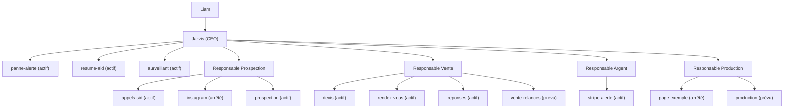

<!-- GENERE:DEBUT (régénéré par python B2B\harness\generer-fiches.py : ne pas modifier) -->
# Organigramme B2B

Généré depuis les contrats (`B2B/harness/contrats`). Liam décide ; Jarvis (CEO) pilote ; chaque responsable pilote ses agents.

- Liam
  - [[jarvis-ceo|Jarvis (CEO)]]
    - [[panne-alerte]] (actif, rattaché directement à Jarvis)
    - [[resume-sid]] (actif, rattaché directement à Jarvis)
    - [[surveillant]] (actif, rattaché directement à Jarvis)
    - [[responsable-prospection|Responsable Prospection]]
      - [[appels-sid]] (actif)
      - [[instagram]] (arrêté)
      - [[prospection]] (actif)
    - [[responsable-vente|Responsable Vente]]
      - [[devis]] (actif)
      - [[rendez-vous]] (actif)
      - [[reponses]] (actif)
      - [[vente-relances]] (prévu)
    - [[responsable-argent|Responsable Argent]]
      - [[stripe-alerte]] (actif)
    - [[responsable-production|Responsable Production]]
      - [[page-exemple]] (arrêté)
      - [[production]] (prévu)

<!-- GENERE:FIN -->

## Notes de Liam

_Zone libre, conservée telle quelle à chaque régénération._
