# Comment ça marche — les agents B2B, du premier contact au paiement

Écrit le 24/11/2026, **relu dans le code** (scripts de `B2B\agents\`, `serveur-taches.json`, contrats `B2B\harness\contrats\`), pas d'après les anciennes descriptions. Quand le code et une fiche se contredisent, c'est le code qui a raison.

**Deux règles valables partout** : (1) un agent ne tourne sur le serveur que s'il a une ligne dans `B2B\agents\serveur-taches.json` *et* que Liam l'a mis dans `agents_actifs` (réglage propre à la machine, que je n'affiche jamais) ; la colonne « État » ci-dessous donne ce que dit le contrat du harness (`actif` / `simulation` = écrit mais n'envoie rien pour de vrai / `inactif` = fermé ou en attente d'un « go »). (2) Ce qui engage Liam (écrire à un client, encaisser, publier) n'est jamais fait par un agent sans son accord : message à valider sur Discord, ou fichier dans `B2B\a-valider\`.

<!-- CARTE:DEBUT (généré par python B2B\harness\architecture.py : ne pas modifier) -->
## Carte du trajet d'un client (générée)

Trait plein = un fichier passe d'un agent au suivant ; **pointillé = maillon manquant** (aucun fichier échangé, ou agent seulement prévu).

```mermaid
flowchart LR
  prospection["Prospection"]
  appels["Appels"]
  chauds["Leads chauds"]
  rdv["Rendez-vous"]
  devis["Devis"]
  paiement["Paiement"]
  production["Production du site"]:::manque
  validation["Validation et mise en ligne"]:::manque
  prospection --> appels
  appels --> chauds
  chauds -.-> rdv
  rdv -.-> devis
  devis -.-> paiement
  paiement -.-> production
  production -.-> validation
  classDef manque stroke-dasharray: 5 5,stroke:#b45309,color:#b45309
```



Maillons manquants : Production du site : agent seulement prévu (contrat sans script) ; Validation et mise en ligne : aucun agent ; Leads chauds → Rendez-vous : aucun fichier échangé entre les deux ; Rendez-vous → Devis : aucun fichier échangé entre les deux ; Devis → Paiement : aucun fichier échangé entre les deux ; Paiement → Production du site : aucun fichier échangé entre les deux ; Production du site → Validation et mise en ligne : aucun fichier échangé entre les deux.
<!-- CARTE:FIN -->

## Le trajet d'un client

```
 TROUVER                   VENDRE (par téléphone et e-mail)                        ENCAISSER             LIVRER
 ───────                   ───────────────────────────────                        ─────────             ──────
 Prospection ──lot e-mail──▶ Liam dit ✅ sur Discord ──▶ e-mail au prospect
     │                                                        │
     └─ liste ──▶ Appels Sid ──▶ Sid appelle, note le « Résultat » dans le tableur
                      │                          │
                      │                          ▼  (À rappeler / Je dois réfléchir)
 Réponses (boîte mail) ──alerte Discord──▶ file « leads chauds » ──▶ Relances (08:00) ──▶ Liam rappelle
                                                                             │
                                                      RDV de 15 min pris dans l'agenda de Liam
                                                                             ▼
                                                 Rendez-vous : annonce Discord + rappel 30 min
                                                                             ▼
                                                 (✋ Liam écrit « devis : … » sur Discord)
                                                                             ▼
                                                 Devis : texte + PDF + aperçu, attend « ok devis »
                                                                             ▼
                                                 (✋ Liam envoie le devis et le lien de paiement)
                                                                             ▼
                                                                  Alerte Stripe : « paiement reçu »
                                                                             ▼
                                                              ❌ Production (n'existe pas encore)
                                                                             ▼
                                                              ❌ Validation de Liam, mise en ligne
```
✋ = action humaine obligatoire · ❌ = maillon manquant. Les traits pleins entre deux agents sont tous **passés par un fichier** (colonne « Qui l'utilise ») ou par Discord vers Liam ; quand je dis « aucun lien », j'ai cherché le nom du fichier dans tous les scripts.

## Les agents, un par un

Légende : **Auto** = tourne seul à heure fixe ou à cadence fixe ; **Humain** = quelqu'un doit agir.

### Trouver
| Agent | But | Déclencheur | Lit → écrit | Qui l'utilise | Auto / humain | Reste à construire |
|---|---|---|---|---|---|---|
| [[docs/agents/🔎 Prospection\|🔎 Prospection]] (`prospection.py`, simulation) | Trouver des entreprises (annuaire officiel, sites publics), préparer des lots d'e-mails, les envoyer **seulement** après ✅ de Liam | Toutes les 10 min : recherche, préparation, publication du lot sur Discord, puis lecture du ✅ de Liam et envoi (10 par boîte et par jour) | Lit annuaire, sites, `prospection-etat.json`, registre ; écrit `prospection-trouves.csv`, `messages-a-valider.md`, `suivi-prospects.csv`, `prospection-etat.json`, registre | `appels-sid` (nouvelles entreprises), `linkedin-equipe` (cibles), `reponses` (statuts, exclusions), `redaction`, `sauvegarde-leads`, tableau de bord | Auto, mais **Humain pour chaque lot** (✅ Discord) | Aucun envoi réel tant qu'il est en simulation ; ne sait pas relier un envoi à un rendez-vous |
| [[docs/agents/📞 Appels Sid\|📞 Appels Sid]] (`appels-sid.py`, simulation) | Chaque jour ouvré à 07:30, un tableur Google de 100 entreprises triées par créneau pour Sid | 07:30 | Lit `prospection-trouves.csv`, API Sirene (créées depuis moins de 3 mois), 3 dernières feuilles de Sid (relit le « Résultat »), registre ; écrit le tableur Drive, registre, `appels-sid-etat.json`, historique, file `leads-chauds.json` | `relances`, `resume-sid`, `superviseur-prospection`, `sauvegarde-leads`, tableau de bord | Auto pour la liste ; **Humain : Sid appelle et note le Résultat** | Aucun retour automatique vers le RDV de 15 min |
| [[docs/agents/🤝 Équipe LinkedIn\|🤝 Équipe LinkedIn]] (`linkedin-equipe.py`, actif) | Préparer le « lot du jour » LinkedIn (post, ~10 commentaires, 20 demandes de connexion, DM, relance) | 08:00, lundi à vendredi | Lit les fichiers de prospects, suivi, registre ; écrit `B2B\linkedin\equipe.json` et les données de la rubrique LinkedIn du tableau de bord | Tableau de bord seulement | **Humain** : Liam envoie tout lui-même, rien n'est envoyé ni scrapé | — |
| [[docs/agents/🌐 Page exemple\|🌐 Page exemple]] (`page-exemple.py`, inactif) | Générer et déployer une page exemple pour un métier/ville/nom | Un message « métier, ville, nom » de Liam sur Discord ; boucle lancée par Jarvis (`lib\page-exemple.ps1`), **pas** par une tâche du serveur | Lit les modèles de pages, écrit la page et `page-exemple-etat.json` | Personne d'autre | Humain (la demande) puis auto | Aucune tâche serveur ; non reliée à un prospect précis |

### Vendre
| Agent | But | Déclencheur | Lit → écrit | Qui l'utilise | Auto / humain | Reste à construire |
|---|---|---|---|---|---|---|
| [[docs/agents/💬 Réponses\|💬 Réponses]] (`reponses.py`, actif) | Lire les réponses des prospects, les classer (positive / négative / STOP / autre), prévenir Liam avec 2 créneaux | Toutes les 15 min | Lit les boîtes mail en lecture seule (seulement les expéditeurs déjà dans `suivi-prospects.csv`) ; écrit `suivi-prospects.csv` (répondu / refusé / STOP), `exclus-emails.json`, `reponses-traitees.json`, alerte Discord | `prospection` (saute les exclus), `superviseur-vente` | Auto ; **Humain : Liam répond** | La réponse courte automatique existe (`reponse_auto.py`) mais son réglage `reponse_auto_envoi` est **faux par défaut** : simulation. Le registre n'est pas mis à jour |
| [[docs/agents/☎️ Relances leads\|☎️ Relances leads]] (`relances.py`, actif) | Un seul message « À rappeler aujourd'hui » à Liam : leads chauds dus ou en retard, puis ceux datés d'aujourd'hui (J+3, J+7, J+15) | 08:00 lundi à vendredi (commandes `rappel` puis `jour`) | Lit la file `leads-chauds.json` et les feuilles de Sid (lecture seule) ; écrit `relances-etat.json`, message Discord | `sauvegarde-leads`, `superviseur-prospection` | Auto ; **Humain : Liam rappelle** (par téléphone) | Ne lit pas le résultat du rappel de Liam |
| [[docs/agents/📅 Rendez-vous\|📅 Rendez-vous]] (`rendez-vous.py`, actif) | Annoncer chaque RDV de 15 min nouveau, déplacé, annulé + rappel 30 min avant | Toutes les 5 min | Lit l'agenda Google par son adresse secrète iCal (lecture seule) ; écrit `rendez-vous-etat.json`, Discord | `superviseur-vente`, tableau de bord | Auto ; **Humain : Liam tient le RDV** | **Aucun lien RDV ↔ prospect** (il ne lit ni ne pose aucun statut) ; pas de fiche avant RDV ; ne déclenche pas le devis |
| [[docs/agents/🧾 Devis\|🧾 Devis]] (`devis.py`, simulation) | Préparer un devis écrit (texte + PDF, numéro DEV-AAAA-NNN) et l'aperçu pour Liam | Toutes les 3 min, mais ne fait quelque chose que sur une fiche ou une ligne « devis : Nom \| métier \| ville \| … » écrite par Liam sur Discord | Lit la fiche, `identite.json`, le « ok devis » de Liam ; écrit les fichiers de `B2B\devis\`, `devis-etat.json` | `chiffres-serveur`, `superviseur-vente`, tableau de bord | **Humain** au début (Liam écrit la ligne) et à la fin (Liam envoie et coche `marquer … envoye / accepte / paye`) | Jamais déclenché par un RDV ; ne lit pas Stripe : « payé » est coché à la main ; personne ne passe le statut du prospect à « devis » ou « signé » |
| [[KIT-RDV-15MIN]] et [[DEVIS-ET-OBJECTIONS]] (documents, pas des agents) | Texte à suivre pendant l'appel et le RDV | — | — | Liam, Sid | Humain | — |

### Encaisser et rendre compte
| Agent | But | Déclencheur | Lit → écrit | Qui l'utilise | Auto / humain | Reste à construire |
|---|---|---|---|---|---|---|
| [[docs/agents/💶 Alerte Stripe\|💶 Alerte Stripe]] (`stripe-alerte.py`, simulation) | Prévenir Liam à chaque nouveau paiement réussi | Toutes les 5 min | Lit les paiements Stripe (clé restreinte, requêtes GET seulement) ; écrit `stripe-alerte-etat.json`, Discord (montant, devise, description) | `superviseur-vente` | Auto | **Ne sait pas à quel devis ni à quel client appartient le paiement** ; ne démarre rien |
| [[docs/agents/📝 Résumé Sid\|📝 Résumé Sid]] (`resume-sid.py`, simulation) | Résumé du soir : appels de Sid par Résultat + chiffre d'affaires Stripe du jour | 19:30, jours ouvrés | Lit les feuilles de Sid du jour et Stripe ; écrit `resume-sid-etat.json`, Discord | Liam | Auto | — |
| [[docs/agents/📊 Chiffres serveur\|📊 Chiffres serveur]] (`chiffres-serveur.py`, inactif) | Une ligne par soir dans la feuille Google « Chiffres serveur Jarvis » : date, devis envoyés, paiements reçus (aucun montant) | 19:30 | Lit `devis-etat.json` et Stripe (nombre seulement) ; écrit la feuille Google | `superviseur-vente` ; courbes Devis et Ventes du gros PC | Auto une fois ouvert | Fermé jusqu'au « go chiffres-serveur » |

### Livrer (rien n'est construit)
| Agent | But | Déclencheur | État réel |
|---|---|---|---|
| [[docs/agents/🏭 Production\|🏭 Production]] | Produire le site du client après paiement, validation de Liam avant mise en ligne | Aucun | **Contrat seulement** (statut `prevu`) : il n'existe pas de script `production.py`. Aujourd'hui, après un paiement, c'est Claude Code, à la demande de Liam, qui construit le site |

### Surveiller et ranger
| Agent | But | Déclencheur | Lit → écrit | Qui l'utilise | Auto / humain | Reste à construire |
|---|---|---|---|---|---|---|
| [[docs/agents/🛡️ Surveillant\|🛡️ Surveillant]] (`B2B\harness\surveillant.py`, simulation) | Signaler sur Discord chaque agent en défaut (silence ou erreur) ; « harness OK » le lundi | 19:45 (lundi aussi 07:50) | Lit les contrats et les traces `B2B\logs\agents` ; écrit sa propre trace | Liam | Auto | — |
| [[docs/agents/🚨 Alerte pannes\|🚨 Alerte pannes]] (`panne-alerte.py`, simulation) | Prévenir Liam si un agent à heure fixe n'a pas tourné après son délai de grâce (une fois par jour) | Toutes les 5 min | Lit `serveur-taches.json`, les journaux, les verrous `go_*` (booléens seulement) ; écrit `panne-alerte-etat.json`, Discord | Liam | Auto | — |
| [[docs/agents/🛒 Superviseur Vente\|🛒 Superviseur Vente]] (`superviseur-vente.py`) | Vérifier que devis, Stripe, chiffres, RDV et réponses ont tourné et ne se contredisent pas ; corrige le sans risque (doublon identique), **n'écrit jamais dans un fichier d'argent** | Toutes les 30 min | Lit les états des agents de vente et leurs traces ; écrit `superviseur-vente-etat.json`, fiche dans `B2B\a-valider`, Discord | Liam | Auto, puis **Humain** (« go » pour l'argent) | Contrat « inactif » : tourne en alerte seulement |
| [[docs/agents/🧭 Superviseur Prospection\|🧭 Superviseur Prospection]] (`superviseur-prospection.py`) | Vérifier relances, appels-sid et prospection ; retirer un doublon identique, remettre l'historique du tableau de bord dans l'ordre | Toutes les 30 min | Lit les états de ces agents et `dashboard\data\historique.json` ; corrige des clés manquantes | Liam | Auto | Idem |
| [[docs/agents/💾 Sauvegarde leads\|💾 Sauvegarde leads]] (`sauvegarde-leads.py`, actif) | Copier chaque nuit leads, appels, résultats, leads chauds et relances dans `B2B\sauvegardes\AAAA-MM-JJ` (30 jours) | 03:30 | Lit registre, `leads-chauds.json`, états, `suivi-prospects.csv`, `prospection-trouves.csv` ; écrit les copies | Restauration à la main (`archive.py`) | Auto | — |
| [[docs/agents/🧹 Nettoyage fichiers\|🧹 Nettoyage fichiers]] (`nettoyage-fichiers.py`, actif) | Supprimer traces et journal de plus de 30 jours, dossiers de test, vieilles sauvegardes, `__pycache__` ; lister le reste dans `B2B\a-valider` | 03:00 | Écrit seulement dans les dossiers qu'il nettoie | Personne | Auto | — |

### Autres, fermés ou à part
| Agent | Rôle | État |
|---|---|---|
| [[docs/agents/🙋 Alerte candidatures\|🙋 Alerte candidatures]] (`alerte-candidatures.py`) | Alerter sur Discord à chaque candidat call caller, relance à 2 h | Fermé jusqu'au « go alerte » (toutes les 5 min une fois ouvert) ; la réponse au candidat n'est jamais envoyée par l'agent |
| [[docs/agents/🌙 Intérim nuit\|🌙 Intérim nuit]] (`interim.py`) | Résumé du matin des offres d'intérim reçues par e-mail (lecture seule), rappel du lundi | Contrat « inactif » ; sans lien avec la vente |
| [[docs/agents/🧠 Cerveau\|🧠 Cerveau]] (`cerveau.py`) | Veille gratuite la nuit, propositions « avant / après » dans le tableau de bord | Fermé (clé `desactive`) jusqu'au « go cerveau » |
| [[docs/agents/🧠 Jarvis (CEO)\|🧠 Jarvis (CEO)]] | Centre du graphe, valide les sorties des agents (`jarvis_sortie.py`) | Pas de script planifié |

**Retirés (24/11/2026), rien n'est supprimé** : l'équipe vidéo / TikTok (superviseur, veille, scripts, marketing, création, monteur, publication, nettoyage, chaîne) est dans `docs\archives\video-tiktok` ; les autres dans `docs\archives\agents-retires` (voir son `LISEZMOI.md`). L'historique complet reste dans git.

<!-- FICHES:DEBUT (généré par python B2B\harness\architecture.py : ne pas modifier) -->
## Fiches de 3 lignes (générées)

**alerte-candidatures**
- Alerter Liam sur Discord à chaque candidature de call caller (brouillon de réponse joint, une relance à 2 h si non contacté) ; fermé jusqu'au « go alerte ».
- Déclencheur : toutes les 5 min, plage tous les jours 00:00-24:00 · auto, puis humain · statut inactif
- Lit : alerte-candidatures-config.json, google-candidatures-token.json · écrit : alerte-candidatures-etat.json · utilisé par : rien

**appels-sid**
- Créer chaque jour ouvré à 07:30 le tableur « Appels Sid AAAA-MM-JJ » de Sid, trié par créneau de 08:00 à 19:00.
- Déclencheur : chaque jour à 07:30, plage lundi-vendredi 07:00-19:00 · auto · statut simulation
- Lit : appels-sid-config.json, appels-sid-historique.json, prospects_maps.csv, registre-entreprises.json · écrit : appels-sid-etat.json, historique-appels.json, leads-chauds.json, registre-entreprises.json · utilisé par : linkedin-equipe, prospection, relances, sauvegarde-leads

**cerveau**
- Veille gratuite la nuit (Ollama local), notes sur 10, une passe Claude par jour pour des propositions avant / après, essai sur petit lot avant de garder ; fermé jusqu'au « go cerveau ».
- Déclencheur : chaque jour à 01:30, plage tous les jours 01:30-03:00 · auto, puis humain · statut inactif
- Lit : cerveau-config.json, idees-master.md, kit-rdv-15min.md, script-appel-sid.md (+4) · écrit : aaaa-mm-jj-cerveau.md, aaaa-mm-jj.md, cerveau.json, etat.json (+1) · utilisé par : rien

**chiffres-serveur**
- Tous les soirs à 19:30, une ligne dans la feuille Google « Chiffres serveur Jarvis » : date, devis envoyés, paiements reçus. Aucun montant, aucune donnée client.
- Déclencheur : chaque jour à 19:30, plage tous les jours 19:00-23:59 · auto · statut inactif
- Lit : chiffres-serveur-config.json, devis-etat.json · écrit : chiffres-serveur-etat.json · utilisé par : rien

**devis**
- Préparer le devis écrit (texte et PDF) à partir d'une fiche, le montrer à Liam et attendre « ok devis » ; rien ne part au client.
- Déclencheur : toutes les 3 min, plage tous les jours 07:00-22:00 · auto, puis humain · statut simulation
- Lit : identite.json · écrit : devis-etat.json · utilisé par : rien

**gardien**
- Chaque dimanche 21:00 : vérifie agents, fiches, liens et échanges de fichiers ; corrige seul le réversible, archive l'inutile, attend le « go » pour tout envoi.
- Déclencheur : chaque jour à 21:00, plage dim 21:00-23:59 · auto, puis humain · statut inactif
- Lit : fiches-noms.json, serveur-taches.json · écrit : aaaa-mm-jj-gardien.md, comment-ca-marche.md, gardien-archives.json, gardien-etat.json · utilisé par : rien

**interim**
- Intérim de nuit / 3x8 autour de Rouen : résumé Discord du matin des alertes d'agences reçues, rappel du lundi par agence ; rien envoyé, aucun compte, aucun document.
- Déclencheur : chaque jour à 07:30 + lundi 09:00, plage tous les jours 07:00-12:00 · auto · statut inactif
- Lit : interim-config.json, interim-suivi.csv · écrit : interim-etat.json, interim-suivi.csv · utilisé par : rien

**jarvis-ceo**
- Lire l'état des responsables, décider, déléguer et prévenir Liam ; ne produit que des décisions structurées (jarvis-sortie.schema.json).
- Déclencheur : à la demande (aucune tâche serveur), plage tous les jours 07:30-21:00 · humain / à la demande · statut simulation
- Lit : todo-b2b.md · écrit : aaaa-mm-jj-jarvis-ceo.md · utilisé par : rien

**linkedin-equipe**
- Prépare le lot LinkedIn du jour (08:00). Mode automatique fermé tant que go_linkedin_auto est false : un geste par passage, arrêt et alerte au moindre avertissement de LinkedIn.
- Déclencheur : toutes les 10 min, plage lundi-vendredi 08:00-19:00 · auto · statut actif
- Lit : file.json, linkedin-equipe-config.json, lot-aaaa-mm-jj.md, prospection-trouves.csv (+4) · écrit : auto-journal.json, equipe.json, linkedin.json, registre-entreprises.json · utilisé par : appels-sid, prospection, sauvegarde-leads

**nettoyage-fichiers**
- Chaque nuit, supprimer traces et journal B2B (30 j), tests de %TEMP% (2 j), sauvegardes (30 j), __pycache__ ; lister le reste (60 j, hors INDEX.md) dans B2B/a-valider.
- Déclencheur : chaque jour à 03:00, plage tous les jours 03:00-04:00 · auto, puis humain · statut actif
- Lit : index.md, journal-b2b.md · écrit : journal-b2b.md, nettoyage-aaaa-mm-jj.md · utilisé par : rien

**page-exemple**
- Générer et déployer une page exemple personnalisée à la demande de Liam sur Discord, depuis un modèle validé.
- Déclencheur : à la demande (aucune tâche serveur), plage tous les jours 08:00-22:00 · humain / à la demande · statut inactif
- Lit : rien · écrit : page-exemple-etat.json · utilisé par : rien

**panne-alerte**
- Alerter Liam sur Discord quand un agent planifié à heure fixe n'a pas tourné après son délai de grâce, une seule fois par jour.
- Déclencheur : toutes les 5 min, plage tous les jours 00:00-24:00 · auto · statut simulation
- Lit : -config.json, b2b.local.json, serveur-taches.json · écrit : panne-alerte-etat.json · utilisé par : rien

**production**
- Produire le site du client après paiement, le faire valider par Liam avant toute mise en ligne.
- Déclencheur : à compléter par Liam · à construire · statut prevu
- Lit : rien · écrit : aaaa-mm-jj-production.md · utilisé par : rien

**prospection**
- Trouver des entreprises locales, préparer les lots d'e-mails, les soumettre à Liam et n'envoyer que les lots approuvés.
- Déclencheur : toutes les 10 min, plage lundi-vendredi 08:00-19:00 · auto · statut simulation
- Lit : prospection-etat.json, registre-entreprises.json · écrit : messages-a-valider.md, prospection-etat.json, registre-entreprises.json · utilisé par : appels-sid, linkedin-equipe, sauvegarde-leads, superviseur-vente

**relances**
- Jours ouvrés à 08:00 : les leads dus ou en retard (file), puis ceux datés d'aujourd'hui (J+3, J+7, J+15), en « À rappeler aujourd'hui » ; ne contacte que Liam.
- Déclencheur : chaque jour à 08:00, plage lundi-vendredi 08:00-19:00 · auto · statut actif
- Lit : appels-sid-config.json, leads-chauds.json, relances-config.json · écrit : relances-etat.json · utilisé par : rien

**rendez-vous**
- Annoncer sur Discord chaque rendez-vous de 15 minutes nouveau, déplacé, annulé ou proche, lu dans l'agenda iCal.
- Déclencheur : toutes les 5 min, plage tous les jours 00:00-24:00 · auto · statut actif
- Lit : rendez-vous-config.local.json · écrit : rendez-vous-etat.json · utilisé par : rien

**reponses**
- Lire les réponses des prospects, les classer et prévenir Liam sur Discord avec deux créneaux proposés ; aucun envoi au prospect.
- Déclencheur : toutes les 15 min, plage tous les jours 00:00-24:00 · auto · statut actif
- Lit : suivi-prospects.csv · écrit : exclus-emails.json, reponses-traitees.json, suivi-prospects.csv · utilisé par : linkedin-equipe, sauvegarde-leads

**resume-sid**
- Poster à 19:30 (jours ouvrés) le résumé du soir : appels de Sid par valeur de Résultat et chiffre d'affaires Stripe du jour.
- Déclencheur : chaque jour à 19:30, plage lundi-vendredi 18:00-23:00 · auto · statut simulation
- Lit : rien · écrit : historique-appels.json, resume-sid-etat.json · utilisé par : sauvegarde-leads

**sauvegarde-leads**
- Chaque nuit à 03:30, copier leads, appels, résultats d'appels, leads chauds et relances dans B2B/sauvegardes (30 jours) ; archive restaurable pour toute suppression ; sans token.
- Déclencheur : chaque jour à 03:30, plage tous les jours 03:30-04:30 · auto · statut actif
- Lit : appels-liam-etat.json, appels-sid-etat.json, appels-sid-historique.json, archive.json (+6) · écrit : archive.json · utilisé par : rien

**stripe-alerte**
- Alerter Liam sur Discord à chaque nouveau paiement Stripe réussi, en lecture seule.
- Déclencheur : toutes les 5 min, plage tous les jours 00:00-24:00 · auto · statut simulation
- Lit : rien · écrit : stripe-alerte-etat.json · utilisé par : rien

**superviseur-prospection**
- Toutes les 30 min : les agents de la prospection ont-ils tourne, un prospect est-il compte deux fois, une date est-elle illogique ? Corrige le sans risque, alerte pour le reste.
- Déclencheur : toutes les 30 min, plage tous les jours 07:00-22:00 · auto · statut inactif
- Lit : appels-sid-etat.json, appels-sid-historique.json, historique.json, prospection-etat.json (+2) · écrit : aaaa-mm-jj-superviseur-prospection.md, appels-sid-etat.json, historique.json, prospection-etat.json (+2) · utilisé par : prospection, sauvegarde-leads

**superviseur-vente**
- Toutes les 30 min : les agents de la vente ont-ils tourne, leurs donnees se contredisent-elles ? Corrige le sans risque, alerte et attend « go » pour tout ce qui touche a l'argent.
- Déclencheur : toutes les 30 min, plage tous les jours 07:00-22:00 · auto, puis humain · statut inactif
- Lit : chiffres-serveur-etat.json, devis-etat.json, messages-a-valider.md, offre-reference.json (+5) · écrit : aaaa-mm-jj-superviseur-vente.md, devis-etat.json, reponses-traitees.json, superviseur-vente-etat.json · utilisé par : chiffres-serveur

**surveillant**
- Lire contrats et traces et signaler sur Discord chaque agent en défaut ; une ligne « harness OK » le lundi.
- Déclencheur : chaque jour à 19:45 + lundi 07:50, plage tous les jours 07:00-20:30 · auto · statut simulation
- Lit : rien · écrit : rien · utilisé par : rien
<!-- FICHES:FIN -->

## Maillons manquants, par effet sur les ventes

1. **Réponse positive → réponse au prospect** : le code existe (`reponse_auto.py`) mais il est en simulation (`reponse_auto_envoi` faux) ; la réponse attend donc Liam. C'est la vente la plus proche.
2. **Rendez-vous → prospect → devis** : le RDV n'est relié à aucun prospect ; le devis n'est jamais déclenché par un RDV ; aucune fiche avant le RDV. Liam doit retaper la ligne « devis : … ».
3. **Devis → paiement → client** : « envoyé / accepté / payé » sont cochés à la main ; le paiement Stripe n'est rattaché à aucun devis ni client ; aucun agent ne pose les statuts « devis » et « signé » dans `suivi-prospects.csv`.
4. **Paiement → fabrication du site** : aucun agent (Production n'est qu'un contrat) ; ni file « à construire », ni fiche client, ni fichier `B2B\a-valider\…-livraison.md`.
5. **Validation avant mise en ligne** : pas de circuit ; `superviseur-sites` (qui relisait les pages) est archivé.
6. **Lead chaud → suite** : `relances` prévient Liam mais ne lit pas le résultat de son appel ; `appels-liam` est archivé.
7. **Visibilité** : les agents n'écrivent pas de « ligne de relais » par événement dans le tableau de bord, et les alertes ne portent ni le nom de l'humain ni l'échéance.
8. **Mesure** : `chiffres-serveur` est fermé, donc les courbes Devis et Ventes du gros PC n'ont pas de source.

Détail des relais événement par événement : [[docs/agents/CARTE-RELAIS|CARTE-RELAIS]]. Entrée du coffre : [[INDEX]].
