<!-- GENERE:DEBUT (régénéré par python B2B\harness\generer-fiches.py : ne pas modifier) -->
# ⛓️ Chaîne vidéo

Sens d'un passage, de bout en bout (06:00, 14:00, 22:00). Rattachée à Jarvis (CEO). Généré depuis les contrats `B2B/harness/contrats/videos-*.json` et `B2B/agents/serveur-taches.json`.

```mermaid
flowchart LR
  ceo["Jarvis (CEO)"] -.-> veille
  veille["🎞️ Veille vidéos (actif)"]
  scripts["✍️ Scripts vidéos (actif)"]
  marketing["📣 Marketing vidéos (actif)"]
  creation["🎬 Création vidéos (actif)"]
  monteur["✂️ Monteur vidéos (actif)"]
  ton_ok["✅ Ton OK de Liam (« go publier », une fois par ligne)"]
  publication["📤 Publication TikTok (arrêté)"]
  nettoyage["🧽 Nettoyage vidéos (actif)"]
  veille -->|"note du jour"| scripts
  scripts -->|"script + légende"| marketing
  marketing -->|"script enrichi : accroche gardée, rythme, sous-titres"| creation
  creation -->|"vidéo rendue"| monteur
  monteur -->|"sketch monté et contrôlé, rangé dans Videos/a-valider"| ton_ok
  ton_ok -->|"ligne ouverte : go_publier = true dans la config locale"| publication
  publication -->|"vidéo publiée, déplacée dans Videos/publiees"| nettoyage
```

| Étape | Agent | Horaire | Statut | Produit |
|---|---|---|---|---|
| 1 | 🎞️ Veille vidéos (`videos-veille`) | chaque jour à 04:30, plage tous les jours 04:30-05:00 | actif | note du jour (Videos/veille) + formules d'accroche (hooks.md) |
| 2 | ✍️ Scripts vidéos (`videos-scripts`) | chaque jour à 05:00, plage tous les jours 05:00-05:45 | actif | script + légende (Videos/scripts/AAAA-MM-JJ-HHMM.json) |
| 3 | 📣 Marketing vidéos (`videos-marketing`) | chaque jour à 05:30, plage tous les jours 05:30-06:15 | actif | script enrichi : accroche gardée, rythme, sous-titres |
| 4 | 🎬 Création vidéos (`videos-creation`) | chaque jour à 06:00, 14:00, 22:00, plage tous les jours 06:00-23:00 | actif | vidéo rendue (ligne A : directement dans Videos/a-valider) |
| 5 | ✂️ Monteur vidéos (`videos-monteur`) | à la demande (aucune tâche serveur), plage tous les jours 06:00-23:00 | actif | sketch monté et contrôlé, rangé dans Videos/a-valider (sinon Videos/a-part) |
| 6 | Ton OK de Liam (« go publier », une fois par ligne) | quand Liam a vu la première vidéo de la ligne | décision de Liam | ligne ouverte : go_publier = true dans la config locale |
| 7 | 📤 Publication TikTok (`videos-publication`) | chaque jour à 06:20, 14:20, 22:20, plage tous les jours 05:15-22:45 | arrêté | vidéo publiée, déplacée dans Videos/publiees |
| 8 | 🧽 Nettoyage vidéos (`videos-nettoyage`) | chaque jour à 03:30, plage tous les jours 03:30-04:15 | actif | vieux fichiers supprimés après une ligne de journal-videos.csv |

- Le Monteur est appelé par la Création pour chaque sketch de la ligne B (aucune tâche à lui) ; la ligne A passe directement de la Création au ton OK.
- Rien n'est publié avant le « go publier » de Liam pour la ligne ; la Publication reste verrouillée (contrat `inactif`).
- Aucun agent vidéo ne tourne tant que Liam ne l'a pas ajouté à `agents_actifs` (`B2B/agents/b2b.local.json`).
- Règles communes : Videos/SKILL-VIDEOS.md (règles communes de l'équipe Vidéos, relues avant chaque exécution ; absentes ou incomplètes = refus, code 3).
- Pas de preuve = pas de fait : l'état de chaque maillon se lit dans sa fiche (rubrique « Horaire et état ») et dans `B2B/logs/agents/<agent>/`.
<!-- GENERE:FIN -->

## Liens et décisions

_Zone conservée à chaque régénération : liens vers docs\decisions et docs clés seulement._

Liens : aucun pour l'instant.

## Notes de Liam

_Zone libre, conservée telle quelle à chaque régénération._
