<!-- GENERE:DEBUT (régénéré par python B2B\harness\generer-fiches.py : ne pas modifier) -->
# 🧠 Jarvis (CEO)

**Agent :** `jarvis-ceo` · **Statut :** actif (simulation : envoi_automatique = false) · **Responsable :** Liam · **Machine :** gros PC
**Horaire :** à la demande (aucune tâche serveur), plage tous les jours 07:30-21:00
**Script :** `.claude/skills/jarvis-ceo/SKILL.md` · **Contrat :** `B2B/harness/contrats/jarvis-ceo.json`

## Rôle et limites
### Mission
Lire l'état des responsables, décider, déléguer et prévenir Liam ; ne produit que des décisions structurées (jarvis-sortie.schema.json).

### Ce qu'il fait étape par étape
- **07 h 45 : brief du matin.** Liste d'appels prête ou non, ce qui attend Liam, la seule action prioritaire du jour.
- **Le soir (19 h) : résumé.** Appels passés, rendez-vous, devis, paiements, ce qui a cassé.
- **Immédiatement : alertes.** Une panne, un paiement reçu ou un rendez-vous pris.

### Ce qu'il n'a pas le droit de faire
- envoyer au client sans accord de Liam
- encaisser ou rembourser
- publier
- signer ou promettre un résultat
- afficher un secret (jeton, clé, adresse iCal)
- promettre au client
- faire la tâche d'un agent
- Engager Liam (envoyer au client, encaisser, publier, signer) : `peut_engager: false`, tout passe par `B2B/a-valider/`.

## Entrées et sorties
**Lit :**
- états et journaux des agents
- B2B/logs/agents
- B2B/docs/TODO-B2B.md

**Écrit :**
- B2B/a-valider/AAAA-MM-JJ-jarvis-ceo.md

**Discord :** alertes · **Plafond :** 6 messages par jour · **Envoi au client :** non

## Horaire et état
- **Horaire :** à la demande (aucune tâche serveur), plage tous les jours 07:30-21:00
- **Tâche serveur :** aucune dans serveur-taches.json
- **Contrat :** valide (`python B2B\harness\valider.py`)
- **Garde branchée :** sans objet : pas de script (sorties validées par jarvis_sortie.py)
- Bloque : kill-switch `B2B\STOP`, lien Stripe non autorisé, phrase interdite (OFFRE-REFERENCE.json), secret dans le texte.
- Avertit : machine non active, envoi_automatique = false (simulation), hors horaires du contrat (07:30-21:00), plafond de 6 messages par jour.
- **Tests :** `tests/agents/test_jarvis_sortie.py`
- **Alerte si silence :** aucune

<!-- DYNAMIQUE:DEBUT -->
**Derniers résultats de test (cette machine) :**
- `tests/agents/test_jarvis_sortie.py` : pas encore lancé par `generer-fiches.py --tests`

**Dernière trace :** aucune · **Dernière erreur :** aucune · **Dans agents_actifs (cette machine) :** non (Liam l'ajoute s'il veut le planifier)

### Historique (5 dernières traces, sans données client)
- aucune trace sur cette machine
<!-- DYNAMIQUE:FIN -->

## Skill et règles
- `.claude/skills/jarvis-ceo/SKILL.md` (copie : `docs/agents/skills/jarvis-ceo.md`)
- Pas de preuve = pas de fait : « il a tourné » = une trace du jour `ok: true` ci-dessus ; « c'est corrigé » = ses tests puis `tests\b2b-rapide.ps1` en vert.

## Responsables

Liam décide ; Jarvis (CEO) pilote ; chaque responsable pilote ses agents et rend compte à Jarvis.

- **Rattachés directement à Jarvis (CEO) :** 🙋 Alerte candidatures (arrêté), 🪟 Vue Jarvis (arrêté), 🧹 Nettoyage fichiers (actif), 🚨 Alerte pannes (actif), 📝 Résumé Sid (actif), 📬 Superviseur Mail (arrêté), 🛡️ Surveillant (actif), 🎬 Création vidéos (actif), 📣 Marketing vidéos (actif), ✂️ Monteur vidéos (actif), 🧽 Nettoyage vidéos (actif), 📤 Publication TikTok (arrêté), ✍️ Scripts vidéos (actif), 🎞️ Veille vidéos (actif).
- **Prospection :** Remplir chaque jour ouvré la journée de vente : entreprises trouvées, lots d'e-mails validés par Liam, liste d'appels prête pour Sid à 7 h 30. Agents : 📞 Appels Liam (actif), 📞 Appels Sid (actif), instagram (arrêté), 🔎 Prospection (actif), 🧭 Superviseur Prospection (arrêté).
- **Vente :** Transformer réponses et rendez-vous en devis montrés à Liam, puis relancer, sans jamais rien envoyer au client sans son accord. Agents : 🧾 Devis (actif), ☎️ Relances leads (actif), 📅 Rendez-vous (actif), 💬 Réponses (actif), 🛒 Superviseur Vente (arrêté), 🔁 Relances (prévu).
- **Argent :** Suivre les paiements Stripe en lecture seule et prévenir Liam de chaque encaissement. Agents : 📊 Chiffres serveur (arrêté), 💶 Alerte Stripe (actif).
- **Production :** Produire les pages et sites des clients, validés par Liam avant toute mise en ligne. Agents : 🌐 Page exemple (arrêté), 🏭 Production (prévu), 🖥️ Superviseur Sites (arrêté).

## Organigramme

Généré depuis les contrats (`B2B/harness/contrats`).

```mermaid
flowchart TD
  liam["Liam"] --> ceo["Jarvis (CEO)"]
  ceo --> alerte_candidatures["🙋 Alerte candidatures (arrêté)"]
  ceo --> jarvis_vue["🪟 Vue Jarvis (arrêté)"]
  ceo --> nettoyage_fichiers["🧹 Nettoyage fichiers (actif)"]
  ceo --> panne_alerte["🚨 Alerte pannes (actif)"]
  ceo --> resume_sid["📝 Résumé Sid (actif)"]
  ceo --> superviseur_mail["📬 Superviseur Mail (arrêté)"]
  ceo --> surveillant["🛡️ Surveillant (actif)"]
  ceo --> videos_creation["🎬 Création vidéos (actif)"]
  ceo --> videos_marketing["📣 Marketing vidéos (actif)"]
  ceo --> videos_monteur["✂️ Monteur vidéos (actif)"]
  ceo --> videos_nettoyage["🧽 Nettoyage vidéos (actif)"]
  ceo --> videos_publication["📤 Publication TikTok (arrêté)"]
  ceo --> videos_scripts["✍️ Scripts vidéos (actif)"]
  ceo --> videos_veille["🎞️ Veille vidéos (actif)"]
  ceo --> r_prospection["Responsable Prospection"]
  r_prospection --> appels_liam["📞 Appels Liam (actif)"]
  r_prospection --> appels_sid["📞 Appels Sid (actif)"]
  r_prospection --> instagram["instagram (arrêté)"]
  r_prospection --> prospection["🔎 Prospection (actif)"]
  r_prospection --> superviseur_prospection["🧭 Superviseur Prospection (arrêté)"]
  ceo --> r_vente["Responsable Vente"]
  r_vente --> devis["🧾 Devis (actif)"]
  r_vente --> relances["☎️ Relances leads (actif)"]
  r_vente --> rendez_vous["📅 Rendez-vous (actif)"]
  r_vente --> reponses["💬 Réponses (actif)"]
  r_vente --> superviseur_vente["🛒 Superviseur Vente (arrêté)"]
  r_vente --> vente_relances["🔁 Relances (prévu)"]
  ceo --> r_argent["Responsable Argent"]
  r_argent --> chiffres_serveur["📊 Chiffres serveur (arrêté)"]
  r_argent --> stripe_alerte["💶 Alerte Stripe (actif)"]
  ceo --> r_production["Responsable Production"]
  r_production --> page_exemple["🌐 Page exemple (arrêté)"]
  r_production --> production["🏭 Production (prévu)"]
  r_production --> superviseur_sites["🖥️ Superviseur Sites (arrêté)"]
```

<!-- GENERE:FIN -->

## Liens et décisions

_Zone conservée à chaque régénération : liens vers docs\decisions et docs clés seulement._

Au centre : il lance, surveille et arrête les agents. « Jarvis stop » = arrêt d'urgence.
Liens : [[docs/agents/📞 Appels Liam|📞 Appels Liam]] · [[docs/agents/🙋 Alerte candidatures|🙋 Alerte candidatures]] · [[docs/agents/📝 Résumé Sid|📝 Résumé Sid]] · [[docs/agents/🚨 Alerte pannes|🚨 Alerte pannes]] · [[docs/agents/🛡️ Surveillant|🛡️ Surveillant]] · [[docs/agents/🧹 Nettoyage fichiers|🧹 Nettoyage fichiers]] · [[docs/agents/🔁 Relances|🔁 Relances]] · [[docs/agents/🏭 Production|🏭 Production]] · [[docs/agents/🎞️ Veille vidéos|🎞️ Veille vidéos]] · [[docs/agents/✍️ Scripts vidéos|✍️ Scripts vidéos]] · [[docs/agents/🎬 Création vidéos|🎬 Création vidéos]] · [[docs/agents/📤 Publication TikTok|📤 Publication TikTok]] · [[docs/agents/📣 Marketing vidéos|📣 Marketing vidéos]] · [[docs/agents/🧽 Nettoyage vidéos|🧽 Nettoyage vidéos]] · [[docs/agents/✂️ Monteur vidéos|✂️ Monteur vidéos]] · [[docs/agents/⛓️ Chaîne vidéo|⛓️ Chaîne vidéo]] · [[docs/agents/🛒 Superviseur Vente|🛒 Superviseur Vente]] · [[docs/agents/🧭 Superviseur Prospection|🧭 Superviseur Prospection]] · [[docs/agents/🖥️ Superviseur Sites|🖥️ Superviseur Sites]] · [[docs/agents/📬 Superviseur Mail|📬 Superviseur Mail]] · [[docs/agents/🪟 Vue Jarvis|🪟 Vue Jarvis]]
Décisions qui le cadrent : [[docs/decisions/📌 Offre 595 + 49|📌 Offre 595 + 49]] · [[docs/decisions/📌 Sans acompte|📌 Sans acompte]] · [[docs/decisions/📌 Serveur HLQSTAU|📌 Serveur HLQSTAU]] · [[docs/decisions/📌 Validation à la main|📌 Validation à la main]] · [[docs/decisions/📌 INDEX d'abord|📌 INDEX d'abord]] · [[docs/decisions/📌 Instagram retiré|📌 Instagram retiré]]

## Notes de Liam

_Zone libre, conservée telle quelle à chaque régénération._
